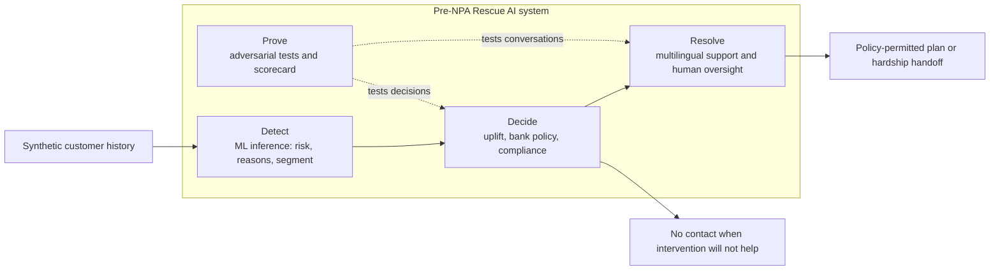
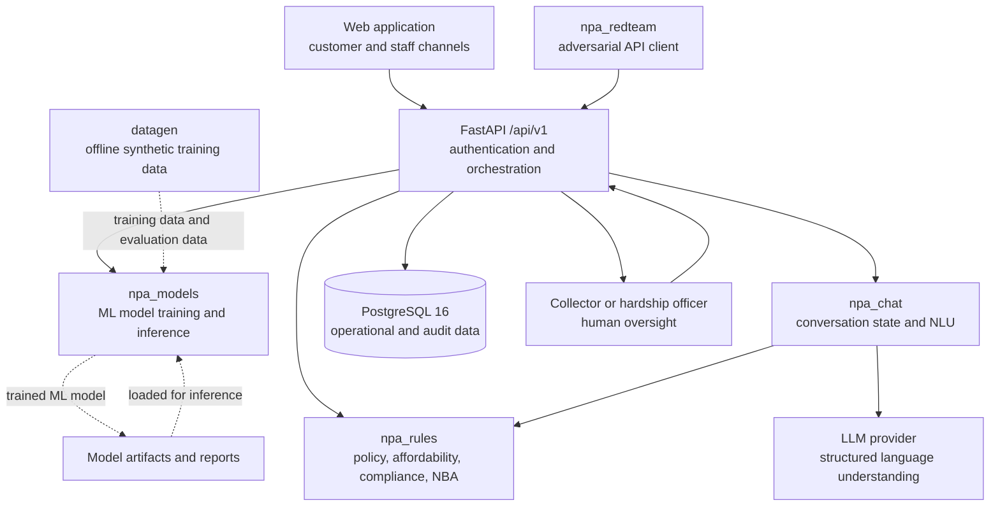
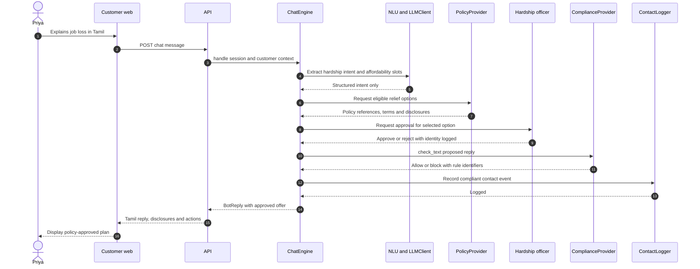
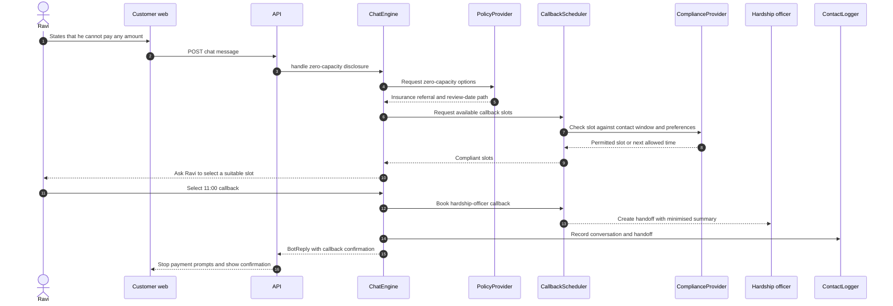
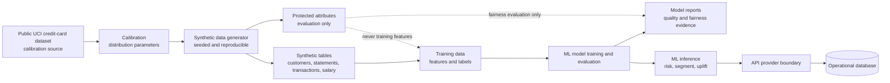

# Architecture

Pre-NPA Rescue is an AI system for intervention before credit-card accounts reach the day-90
NPA threshold. It separates ML inference from policy decisions: ML models estimate risk and
treatment effect, while deterministic bank-policy and compliance components decide which
actions are allowed. Human oversight is required for relief offers.

This document uses the lifecycle vocabulary of IS/ISO/IEC 22989:2022 and the ML framework
vocabulary of IS/ISO/IEC 23053:2022. The references indicate design alignment, not
certification.

## Four-layer overview

Detect produces decision support, not an offer. Decide combines ML inference with the
simulated board-approved policy. Resolve presents only a permitted option and preserves human
oversight. Prove tests decision and conversation behaviour against RBI controls and relevant
Indian Standards.

Evidence: [`contracts/fixtures/nba.json`](../contracts/fixtures/nba.json),
[`contracts/fixtures/offer.json`](../contracts/fixtures/offer.json), and
[`contracts/fixtures/scorecard.json`](../contracts/fixtures/scorecard.json).

## Component architecture

The API wires packages through provider protocols in `npa_contracts`; it does not depend on
their internal implementations. The LLM extracts language intent and slots. It is not the
source of amounts, waivers or promises. Those values come from `npa_rules`, and customer
contact is checked and logged.

Evidence: [`contracts/README.md`](../contracts/README.md),
[`services/api/README.md`](../services/api/README.md),
[`packages/models/README.md`](../packages/models/README.md),
[`packages/rules/README.md`](../packages/rules/README.md), and
[`packages/chatbot/README.md`](../packages/chatbot/README.md).

## Priya: policy-controlled chat turn

The committed fixture illustrates an approved offer of ₹2,000 per month for 6 months with
₹1,180 in late fees waived. These are fixture values, not measured results, and must be
rechecked against the integrated rules provider before `demo-freeze`.

Evidence: [`contracts/fixtures/bot_reply_offer.json`](../contracts/fixtures/bot_reply_offer.json)
and [`contracts/schemas/BotReply.schema.json`](../contracts/schemas/BotReply.schema.json).

## Ravi: zero-capacity handoff

The compliance window is evaluated in Asia/Kolkata and is constrained to 08:00–19:00. The
customer's preferred or avoided times must further restrict the available slots. The fixture
books 11:00 IST and flags `zero_capacity` and `handoff_booked`.

Evidence:
[`contracts/fixtures/bot_reply_zero_capacity.json`](../contracts/fixtures/bot_reply_zero_capacity.json),
[`contracts/fixtures/callback.json`](../contracts/fixtures/callback.json), and
[`contracts/schemas/ComplianceDecision.schema.json`](../contracts/schemas/ComplianceDecision.schema.json).

## Data and ML lifecycle

All customer records are synthetic. The public dataset is a calibration input; it is not
served by the application. Protected attributes are separated from training features and are
used only for fairness evaluation and bias-swap tests. Model artifacts are not committed;
reports and small evidence samples are.

Evidence: [`contracts/data/customers.md`](../contracts/data/customers.md),
[`contracts/data/features.md`](../contracts/data/features.md),
[`contracts/data/protected_attributes.md`](../contracts/data/protected_attributes.md), and
[`contracts/data/experiment.md`](../contracts/data/experiment.md). Dataset attribution remains
pending from `data/ATTRIBUTION.md`.

## Trust boundaries and control points

| Boundary | Control | Evidence status |
|---|---|---|
| Training data → ML model | Synthetic lineage, deterministic seed and protected-attribute separation | Contract verified; implementation evidence pending WS1/WS2 |
| ML inference → next action | Uplift group plus deterministic policy and compliance rules | Contract fixtures verified; integrated provider pending |
| LLM → customer reply | Structured NLU only; rules supply monetary terms; output text is checked | Contract/provider design verified; integrated flow pending WS3/WS4 |
| Offer → customer | Human approval and approval identity | Fixture verified; persistence/audit integration pending WS5 |
| Outbound contact → customer | Contact-window and text checks followed by logging | Contract verified; integrated enforcement pending WS3/WS5 |
| AI system → governance | Red-team results mapped to RBI and BIS evidence | Fixture verified; real scorecard and mappings pending WS7 |

## Evidence maturity

The diagrams describe the target MVP architecture defined by committed contracts. A component
shown here is not automatically a claim that its production implementation has merged. Before
`demo-freeze`, replace fixture evidence with:

- `packages/models/reports/metrics.json` and model cards from WS2;
- `redteam/reports/<latest>/scorecard.json` from WS7;
- `governance/rbi_mapping.md` and `governance/bis_mapping.md` from WS7;
- `data/ATTRIBUTION.md` from WS1; and
- integrated API and UI evidence from WS5 and WS6.
